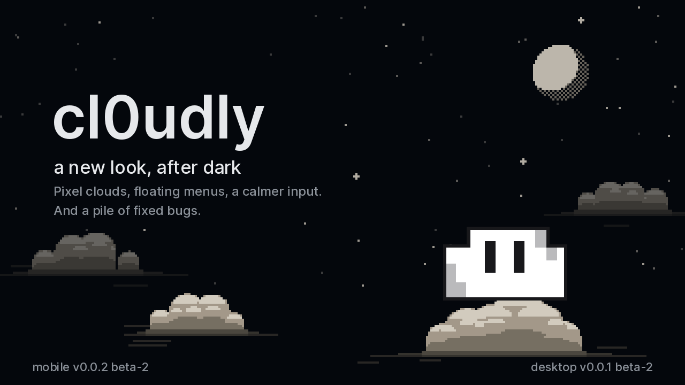

Исправления и новый вид. Установка как раньше:

```bash
curl -fsSL https://raw.githubusercontent.com/mistqkw/cl0udly-desktop/main/get.sh | bash
```

Windows: `…-windows-x64.msi` или `.zip`. macOS: `…-macos-arm64.dmg` (M1 и новее) или `…-macos-x64.dmg` (Intel). Сборки не подписаны, как их открыть, написано в [beta-1](https://github.com/mistqkw/cl0udly-desktop/releases/tag/v0.0.1-beta-1).

**Новый вид**
- Ночное небо с пиксельными облаками за чатом, приглушённое, чтобы не мешать; сам интерфейс спокойный серый
- Новая заставка запуска: звёзды, облака, облачко садится на них

**Что нового**
- Поиск (Ctrl+K) ищет слова внутри сообщений и в памяти, без разницы, большие буквы или маленькие
- Динамик под ответом читает его вслух (голос Piper, если установлен)
- Карточка сверху, когда пропал сервер или интернет; остановленный сервер перезапускается по клику
- Облачко реагирует, когда ответ готов или не удался
- Строки боковой панели можно переставлять: Настройки → Внешний вид
- Поле ввода с тонкой рамкой и одной кнопкой, плавно растёт до 8 строк
- Код в ответах с подсветкой и номерами строк; удалённый чат можно вернуть

**Исправлено**
- Ошибка «OK» с GitHub Copilot, сломанные ответы GPT-OSS
- Чат больше не тянет вниз, когда немного прокручиваешь вверх

Это бета, баги будут. Неофициальный клиент, не связан с разработчиками OpenCode.
